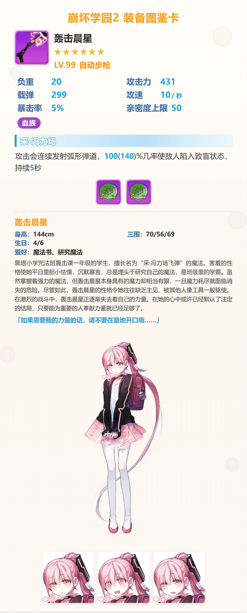
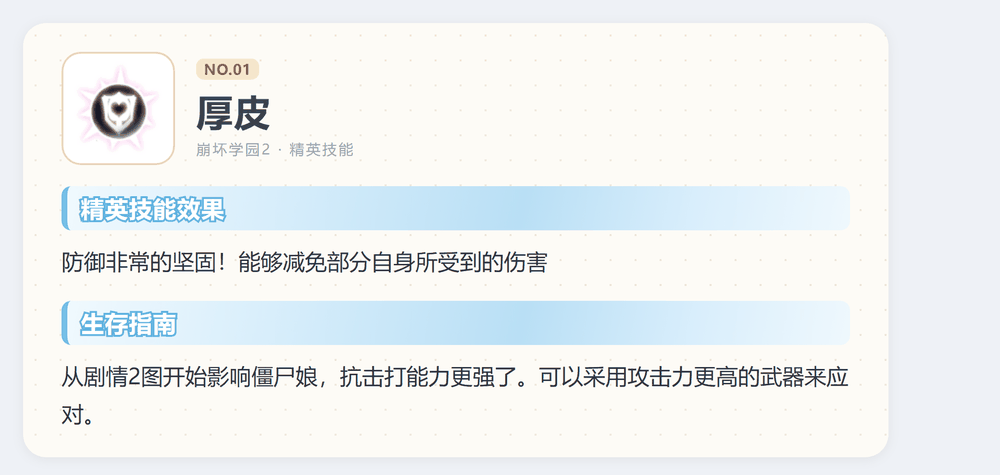
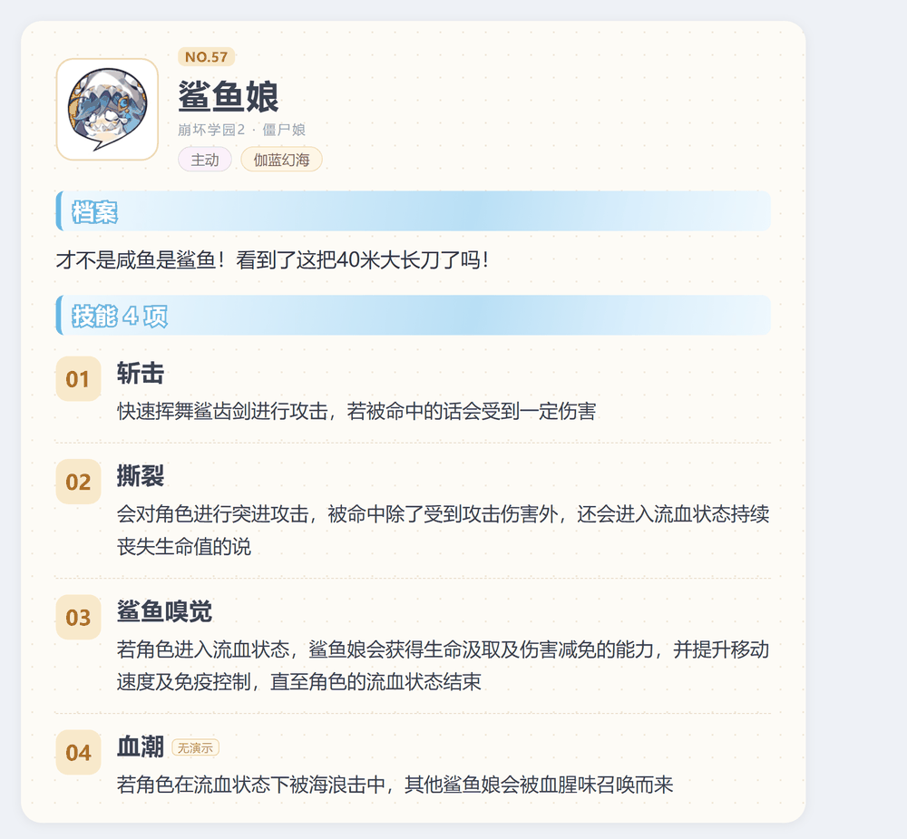
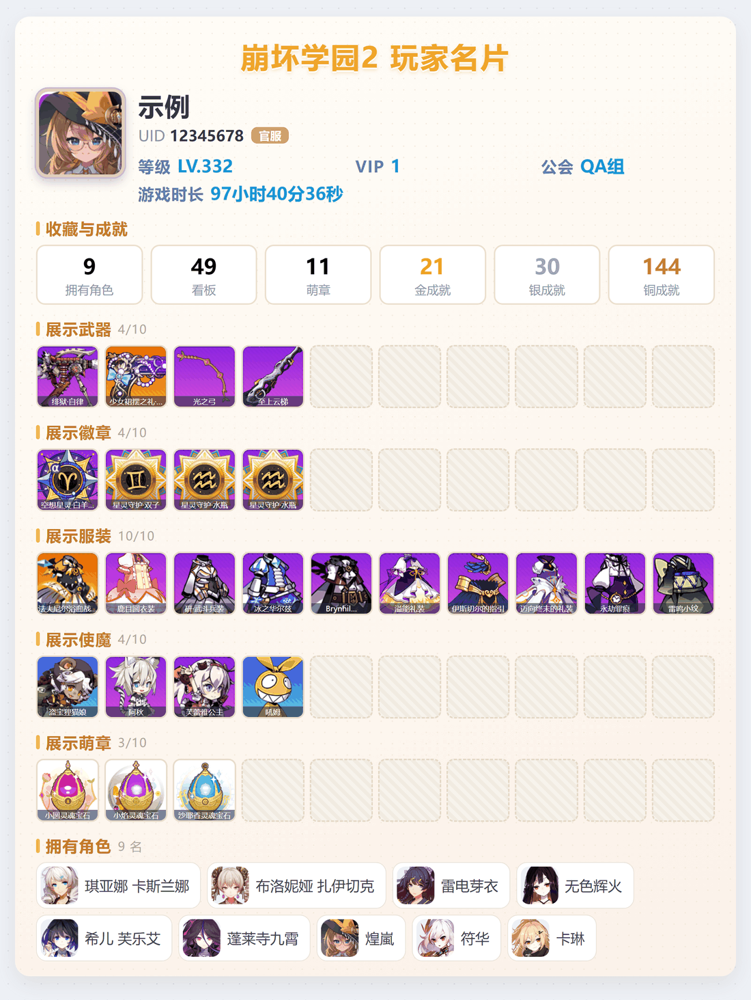
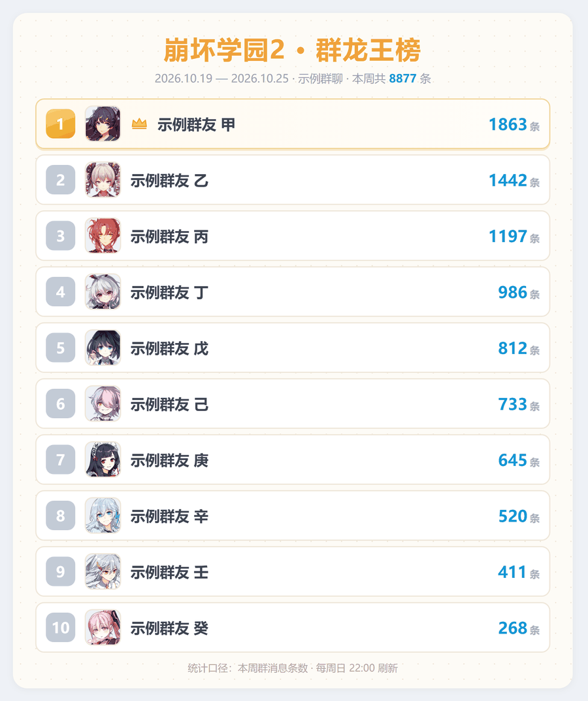

# 使用说明

这份文档分两部分：

* **第一部分**：机器人能干什么、命令是什么、每个功能长什么样；
* **第二部分**：从一台空服务器开始，一步步搭出属于你自己的版本。

所有示例图都是脚本真实产出（玩家名片做了匿名化处理：昵称/UID/公会已替换）。

---

# 第一部分 · 功能与命令

## 命令总表

群聊直接说话即可，**不需要任何前缀**（`.env` 里 `COMMAND_START=[""]`）。

| 分类 | 命令 | 说明 |
|---|---|---|
| 装备 | `装备查询 轰击晨星` | 装备卡（武器/服装/徽章/使魔通用） |
| 立绘 | `立绘查询 琪亚娜` / `CG` | 觉醒立绘、官网 CG（`CG` 单独发列出全部） |
| 角色 | `查询角色 琪亚娜` / `角色语音 琪亚娜` | 角色卡 + 中日语音 |
| 竞猜 | `猜装备` / `猜装备排行榜` | 看图猜装备，群内计分 |
| 娱乐 | `抽老婆` / `换老婆` | 每日 1 抽 1 换 |
| 表情 | `表情包` | 随机精选表情 |
| 技能 | `精英技能` / `查询技能 厚皮` | 58 项精英技能图鉴 |
| 怪物 | `僵尸娘` / `查询怪物 鲨鱼娘` | 58 只僵尸娘图鉴（卡 + 合并动图） |
| 名片 | `查询玩家 12345678` / `查询官服玩家 22334455` | 玩家名片（双区服） |
| 名片 | `绑定玩家 12345678` / `查询自己` / `查询@某人` / `我的绑定` / `解绑玩家` | 绑定与自助查询 |
| 榜单 | `群龙王` | 本周群聊发言排行 |
| 推送 | `开启公告` / `关闭公告` | B 站官方账号动态 |
| 推送 | `开启官网公告` / `关闭官网公告` | 官网公告 |
| 管理 | `新增回复` / `查询回复` / `修改回复` / `删除回复` | 固定回复（管理员） |
| 管理 | `开启功能` / `关闭功能` / `功能列表` / `开启全部功能` / `关闭全部功能` | 群级开关（管理员） |
| 运维 | `守护状态` | NapCat 守护日志（管理员） |

> 「管理员」由 `.env` 的 `BOT_ADMINS` 指定，留空则这些命令无人可用。

---

## 1. 装备查询

**命令**：`装备查询 <名称或ID>`，别名 `查询装备` / `查装备` / `查图鉴` / `查询图鉴` / `装备`

**返回**：一张卡（不再是纯文字）。武器/服装/徽章/使魔四类共用一套模板，差别只在属性块：

| 类型 | 属性块字段 |
|---|---|
| 武器 | 负重 / 攻击力 / 载弹 / 攻速 / 暴击率 / 亲密度上限 |
| 服装 | 负重 / 生命 / 亲密度上限 |
| 徽章 | 负重 / 亲密度上限 |
| 使魔 | 攻击力（满级伤害）/ 暴击率 + 词条图标行 |



卡片内容：名称、稀有度星级、`LV.99 类型`、属性块（数值为 0 的字段自动隐藏）、
技能条（浅蓝斜纹 + 白字蓝描边标题 + 蓝色数字）、觉醒块（角色名/身高·三围·生日/爱好/
介绍/台词/立绘）、底部表情差分（该角色有差分时才有）、免责声明。

**数值规则**：解包文本 `基础(+a每级/+b每破)` → 满级 `X = 基础 + a×(MaxLv−1)`，
满破 `Y = X + b×10`，显示成 `X(Y)`。见 `docs/02-图鉴表构建.md`。

**多命中**：同一个名字有 5★/6★ 两种时，会先把候选列出来，回复序号看详情。

---

## 2. 立绘查询 / CG

**命令**：`立绘查询 <角色名>`，别名 `查询立绘` / `查立绘` / `觉醒查询` / `立绘` / `觉醒`；
`CG` / `CG查询` 单独发会列出全部官网 CG。


数据来源：`materials/觉醒立绘/`（本地导出）+ `materials/官网CG/`（官网下载页 142 张）。

---

## 3. 角色查询与语音

**命令**：`查询角色 <角色名>`，别名 `角色查询` / `查角色` —— 发角色卡 + 一条中文 + 一条日文语音；
`角色语音 <角色名>` 随机一条中文，`角色语音 <角色名> 日文` 随机一条日文。


语音全部本地化在 `materials/角色卡/<id>/voice/{china,japan}/*.mp3`，不联网。

> 角色卡不是解包做的：立绘 / 档案 / 标题 / 语音都来自官网角色板块
> `static-event.benghuai.com/new_mihoyo_homepage/chara/{id}/`，26 个角色 id 从官网首页取；
> 每张卡的排版参数（镜像、水平位移、档案文案）都单独调过，细节见 [06-素材来源一览.md](06-素材来源一览.md)。

---

## 4. 猜装备

**命令**：`猜装备`（启动一轮，60 秒；答对加分，答错不扣）、`猜装备排行榜`


分数存在 `bh2.db` 的 `guess_rank` 表，按群独立计分。

---

## 5. 抽老婆 / 换老婆

**命令**：`抽老婆`（别名 `随机老婆` / `抽一个老婆`）、`换老婆`（别名 `更换老婆` / `换一个`）

规则：每人每天 1 次「抽」+ 1 次「换」，跨日期自动刷新；「换」必须先抽过；
管理员（`BOT_ADMINS`）不受次数限制。结果是随机角色卡 + 一段随机语音。


---

## 6. 表情包

**命令**：`表情包`，别名 `随机表情包` / `表情` / `发个表情` / `来个表情`


素材放 `materials/精选表情图/<分组>/*.png`，按分组归类，随机抽一张。

> 这批图来自官网下载页 <https://www.benghuai.com/download/> 的「表情包」区：
> 每套下载下来是 `.eif`（其实是 **OLE2 复合文档**，不是图片），用 7-Zip 或 `olefile` 把里面的 PNG 解出来即可；
> 本项目整理了 17 套。详见 [06-素材来源一览.md](06-素材来源一览.md)。

---

## 7. 精英技能图鉴

**命令**：
* `精英技能` —— 只回一张汇总图（58 项图标 + 编号 + 名称）
* `查询技能 厚皮` / `精英技能 01` / `查询精英技能 no.2` —— 单项卡 + 演示动图



数据来自官网数据站 `benghuai.com/data`（`type=elite_skill`），不依赖解包。
汇总图也是脚本生成的，可自己重跑 `cards/build_elite_sheet.py`。

**多命中**：`精英技能 结界` 会列出 6 条候选，回复编号看详情（会话 15 分钟内有效）。

---

## 8. 僵尸娘图鉴

**命令**：
* `僵尸娘` —— 汇总图
* `查询僵尸娘 鲨鱼娘` / `查询怪物 NO.57` / `怪物查询 57` —— 资料卡 + 合并演示动图
* 触发词任意：`查询僵尸娘` / `僵尸娘查询` / `查询怪物` / `怪物查询` / `僵尸娘` / `怪物`



**不刷屏的设计**：无论这只僵尸娘有 1 个还是 4 个技能，永远只发 **2 条消息** ——
资料卡（全部技能文案）+ 一张把所有技能演示纵向拼起来的 GIF。
没有演示的技能在卡上标「无演示」，0 技能的（梅露可）只发卡。

---

## 9. 玩家名片查询

**命令**：

| 命令 | 作用 |
|---|---|
| `查询玩家 12345678` | 默认 B 服 |
| `查询b2玩家 12345678` / `查询b服玩家 …` / `查询哔哩哔哩玩家 …` | 指定 B 服 |
| `查询官服玩家 22334455` / `查询国服玩家 …` / `查询gf玩家 …` | 指定官服 |
| `查询 12345678` | 省略「玩家」二字 |
| `查询自己` | 查自己绑定的号 |
| `查询@某人` | 查对方绑定的号（需对方绑定过） |
| `绑定玩家 12345678` / `绑定官服玩家 22334455` | 绑定（可带区服） |
| `我的绑定` / `解绑玩家` | 查看 / 解除绑定 |

限流：**每人 3 分钟一次**，管理员不限。



名片内容：头像、昵称、UID、区服徽标、等级、VIP、公会、游戏时长（时/分/秒）、
收藏与成就 6 格（角色 / 看板 / 萌章 / 金 / 银 / 铜）、展示武器 / 徽章 / 服装 / 使魔 / 萌章
（每行 10 格，空的整块跳过）、对外展示的履历、拥有角色列表。

数据全部来自游戏网关（`0x0029` 摘要 + `0x02b2` 详情），**不需要游戏客户端**，
协议细节见 [05-玩家名片协议.md](05-玩家名片协议.md)。这条功能是可选的，
不配置就只是少了这个命令。

---

## 10. 群龙王榜

**命令**：`群龙王` —— 发当前周的发言排行图（前 10 名）

每周日 22:00 自动把当周榜单推到每个有记录的群。



规则：消息计数不分文字/图片/表情（只统计群消息）；昵称优先取群名片，其次 QQ 昵称；
头像每次渲染时抓取并缓存；`msg_stat` 按「群 + QQ + 周」三键累计，
`week_key()` 用自然周（周一为起点）。

---

## 11 / 12. 动态与公告推送

**命令**：`开启公告` / `关闭公告`（B 站官方账号动态，默认每小时检查一次）；
`开启官网公告` / `关闭官网公告`（官网公告，默认每 6 小时）。

推送内容形如：

```
【B站动态】灵依娘更新了动态
13.5 版本「星海漫游」前瞻
2026-10-24 12:00
https://t.bilibili.com/1xxxxxxxxxxxxxxxxx
```

**防「旧内容当新内容」**：只推发布时长在 `ANNOUNCE_FRESH_HOURS`（默认 24h）/
`NEWS_FRESH_HOURS`（默认 72h）内的条目；置顶动态只记录不推送；
拿不到发布时间的条目**放行**（宁可多推一条，不漏推）。

---

## 13. 固定回复

**命令**（管理员）：

```
新增回复 关键词 = 回复内容
新增全局回复 关键词 = 回复内容
修改回复 <编号> 新内容
删除回复 <编号>
查询回复
```

群内触发词命中即回复；`新增全局回复` 的条目对所有群生效。
回复内容支持 `{at}`（@ 触发者）等占位符。

---

## 14. 群功能开关

**命令**（管理员）：

```
功能列表
关闭功能 装备查询
开启功能 装备查询
关闭全部功能
开启全部功能
```

可开关的模块：装备查询 / 立绘查询 / 角色查询与语音 / 猜装备 / 抽老婆 / 表情包 /
固定回复 / 玩家查询 / 群龙王榜 / 精英技能 / 僵尸娘图鉴。
开关按群独立记录（`module_switch` 表），新群默认全开。

---

## 15. NapCat 守护

`deploy/napcat-guard.sh` 每 60 秒做三件事：

1. `docker inspect` 看容器是否在跑；
2. `pgrep` 看容器里的 QQ 进程是否还在；
3. `curl` 探 OneBot 的 HTTP 端口。

任一项失败 → `docker restart napcat` → 每 3 秒复查、最多 90 秒 → 5 分钟冷却。
恢复后把「掉线时长」写进 `/var/log/napcat-guard/pending.jsonl`，
由 `guard_alert` 插件推给管理员；管理员也可以发 `守护状态` 看最近 10 条事件。

> 如果重启后需要重新扫码登录，就把脚本里的 `docker restart` 改成只记录不重启。

---

# 第二部分 · 从零搭建

## 0. 你需要什么

| 项 | 建议 |
|---|---|
| 服务器 | 1 核 2G 起（只发图）；4 核 4G 更稳（要渲染玩家名片） |
| 系统 | Ubuntu 22.04 / 24.04，或任何能跑 Docker 的 Linux |
| 软件 | Python 3.10+、Docker、Chrome/Chromium（渲染卡片用） |
| QQ | 一个小号（强烈建议，不要用主号） |
| 素材来源 | 自己设备上装的游戏客户端（APK 或热更资源） |

**没有素材也能先跑起来**：解包、图鉴表、出卡这三步是「素材生产」，
可以后面做；机器人本体只要 `.env` 配好、NapCat 通了就能起，
只是查不到东西。

---

## 1. 拉代码装依赖

```bash
git clone <this repo> bh2-toolkit
cd bh2-toolkit

python3 -m venv venv
source venv/bin/activate
pip install -r requirements.txt
pip install -r bot/requirements.txt
```

---

## 2. 解包拿素材

> 这一步需要 **你自己设备上的游戏资源**。仓库不提供任何游戏文件。
> 完整参数见 [01-解包与素材提取.md](01-解包与素材提取.md)。

### 2.1 拿到资源包

两种方式，任选：

* **APK**：从自己设备上备份已安装的 APK，放 `data/apk/bh2.apk`
  → `python unpack/apk_extract.py`
* **热更资源**（更全，推荐）：设备里
  `/sdcard/Android/data/com.miHoYo.HSoDv2BiliBiliRelease/files/Res/AssetBundles/`
  下的 `*.unity3d`（两千多个），整个 `adb pull` 到 `data/dev_bundles/AssetBundles/`

### 2.2 解密与导出

```bash
python unpack/bundle_decrypt.py     # 主数据包 → data/tsv/
python unpack/export_tables.py      # 整理成 data/tsv_all/*.txt
python unpack/export_textures.py    # 纹理（装备图标等）→ data/textures/
python unpack/export_figures.py     # 觉醒立绘 → materials/觉醒立绘/
python unpack/export_faces.py       # 表情差分 → materials/表情差分/
python unpack/export_costume_atlas.py  # 服装拆件图集（可选）
```

13.4+ 的包是 GGZV2（AES-CBC + 16 字节尾），`unpack/gzzv2.py` 会挂进 UnityPy；
不挂就会看到 `LZ4 decompress failed: error code 110`。

### 2.3 把素材放到 `materials/`

```
materials/
├─ 图标/              装备图标（<图标ID>.png）
├─ 觉醒立绘/          <FigureID>_<角色名>.png
├─ 表情差分/          <FigureID>_001..005.png
├─ 角色卡/<角色>/      assets/role.png + voice/{china,japan}/*.mp3
├─ 精选表情图/<分组>/*.png
├─ 装备卡/{装备卡,服装卡,徽章卡,使魔卡}/PNG/
├─ 精英技能/{cards,gif,icons,index.json}
├─ 僵尸娘/{cards,gif,icons,index.json}
├─ 官网CG/
├─ 玩家名片/{data.json,avatars,emblems,roles,out}
└─ 龙王榜/{avatars,out}
```

`materials` 的位置由 `.env` 的 `MATERIAL_ROOT` 决定，机器人每次启动读一次。

---

## 3. 生成图鉴表

`装备查询` / `猜装备` / `立绘查询` 都依赖一张 Excel（`.xlsx`），
四张 sheet 名字固定：`武器` / `服装` / `使魔-被动技能` / `宠物`。

必需列：`内部ID`、`游戏内ID`、`名称`、`稀有度`、`最大等级`、`装备状态`、`系列`、
`武器类型`、`图标ID`、`图标文件`、`技能（解包原文）`、`描述（解包原文）`、`装备别名（社区）`。

从解包表构建这套 xlsx 的完整流程（每个字段怎么算、哪些坑）见
[02-图鉴表构建.md](02-图鉴表构建.md)。放到 `tables/bh2_codex.xlsx`。

---

## 4. 出卡

```bash
cd cards
python batch.py            # 武器（同名按最高稀有度去重）
python batch_fz.py         # 服装
python batch_badge.py      # 徽章
python batch_pet.py        # 使魔
python verify_batch.py     # 检查有没有卡被裁掉
```

产物直接落 `materials/装备卡/**/PNG/`，HTML 与浏览器临时目录落 `_tmp/卡牌build/`。

官网上有现成数据的两类不用解包：

```bash
python build_skill_card.py --fetch && python batch_skill_cards.py && python build_elite_sheet.py
python build_zombie.py 57 && python batch_zombie.py && python build_zombie_sheet.py
```

---

## 5. 建数据库

```bash
cd bot
python tools/import_db.py            # → bot/bh2.db
```

它会：读图鉴表建 `equip` 表（每个稀有度一行，4254 行）、建 `illust`/`illust_equip`
（觉醒立绘索引）、扫描 `materials/装备卡/**/PNG` 建立「编号 → 卡图」索引。

其余表（`guess_rank` / `msg_stat` / `module_switch` / `auto_reply` / `wife_record` /
`announce_seen` / `player_bind` …）由各插件首次启动时自动建，不用手工初始化。

路径都可用环境变量覆盖：`BH2_XLSX` / `BH2_ILLUST_XLSX` / `MATERIAL_ROOT` / `BH2_DB`。

---

## 6. 部署 NapCat（QQ 网关）

```bash
mkdir -p /opt/bh2-bot/napcat/config
docker run -d --name napcat --restart=always \
  -p 3000:3000 -p 3001:3001 -p 6099:6099 \
  -e NAPCAT_UID=0 -e NAPCAT_GID=0 \
  -v /opt/bh2-bot/napcat/config:/app/napcat/config \
  -v /opt/bh2-bot/materials:/app/materials \
  mlikiowa/napcat-docker:latest
```

1. 浏览器打开 `http://<服务器IP>:6099` 扫码登录小号；
2. 进「网络配置」新增 **WebSocket 客户端**（反向 WS）：
   `ws://127.0.0.1:8080/onebot/v11/ws`，Token 与 `.env` 的 `ACCESS_TOKEN` 一致；
3. `-v .../materials:/app/materials` 这行很关键 —— 机器人发图时给的是**绝对路径**，
   NapCat 必须能在同一路径读到文件。

> 6099 是 NapCat 的 WebUI，别长期裸奔在公网，用完把端口映射去掉或加防火墙。

---

## 7. 配置 `.env`

```bash
cd /opt/bh2-bot/bot
cp .env.example .env
vi .env
```

最少改这三行：

```ini
ACCESS_TOKEN=你自己编的随机串      # 与 NapCat 的 WS Token 一致
MATERIAL_ROOT=/opt/bh2-bot/materials
BOT_ADMINS=你的QQ号               # 可以逗号分隔写多个
```

其它按需：

| 键 | 作用 |
|---|---|
| `COMMAND_START=[""]` | 命令无前缀（想用 `/装备查询` 就改成 `["/"]`） |
| `HOST` / `PORT` | OneBot 监听地址，默认 `127.0.0.1:8080` |
| `BILI_COOKIE` | 带 `SESSDATA` 能显著降低 B 站接口 412 的概率 |
| `ANNOUNCE_FRESH_HOURS` / `NEWS_FRESH_HOURS` | 推送新鲜度窗口 |
| `BH2_QUERY_API` / `BH2_SERVERS` | 只有用玩家名片才需要 |

---

## 8. 启动与自检

```bash
cd /opt/bh2-bot/bot
source /opt/bh2-bot/venv/bin/activate
python bot.py
```

日志里每个插件都会打一行，确认没有 `Failed to load`：

```
Succeeded to load plugin "equip_query" ...
Succeeded to load plugin "elite_skill" ...
Succeeded to load plugin "zombie" ...
```

进群里依次试：`装备查询 轰击晨星` → `精英技能` → `僵尸娘` → `群龙王`。

**排查顺序**：机器人不回 → 先看 NapCat 日志连没连上；连上不回 → 看群号是否在
NapCat 的群列表里、`COMMAND_START` 是否匹配；回文字不发图 → 九成是
`MATERIAL_ROOT` 路径不对，或 NapCat 容器里读不到该路径。

---

## 9. 常驻与守护

```bash
sudo cp deploy/bh2-bot.service /etc/systemd/system/
sudo systemctl daemon-reload
sudo systemctl enable --now bh2-bot

# NapCat 守护（可选但推荐）
sudo cp deploy/napcat-guard.sh /usr/local/bin/ && sudo chmod +x /usr/local/bin/napcat-guard.sh
sudo cp deploy/napcat-guard.service /etc/systemd/system/
sudo systemctl enable --now napcat-guard
```

单元文件里的路径默认按 `/opt/bh2-bot` 写，放在别处要改 `WorkingDirectory` / `Environment`。

需要渲染中文的话装个字体，否则卡片文字会变方块：

```bash
sudo apt install -y fonts-wqy-zenhei fonts-noto-cjk
```

---

## 10.（可选）玩家名片

这条功能要**自己抓一次包**拿到四参数，再起一个常驻服务。步骤：

1. 装一个能 root 的模拟器（MuMu / 夜神都行），装游戏、登录小号；
2. `tcpdump` 抓游戏网关的 TCP 包（排除 443）；
3. 用 `python unpack/pcap_scan.py cap.pcap` 找到与网关的连接，导出字节流；
4. 按 [05-玩家名片协议.md](05-玩家名片协议.md) 里的帧格式，找出登录帧、会话号、网关地址；
5. 写 `servers.json`（复制 `servers.example.json` 改），填 `host` / `session` / `own_uid` / `login_hex`；
6. 起服务：

```bash
sudo cp deploy/bh2-query.service /etc/systemd/system/
sudo systemctl enable --now bh2-query
curl -s http://127.0.0.1:8791/status
```

`connected: true` 就成了，群里发 `查询玩家 <uid>` 试试。

**风险提示**：这是复用账号登录态的私有协议，可能触发风控。
用小号、别高频查询、别在官方明令禁止的场景使用。

---

## 常见问题

| 现象 | 原因 / 处理 |
|---|---|
| 卡片里的中文变方块 | 缺中文字体，装 `fonts-wqy-zenhei`；或改 `cards/paths.py` 的 `FONT_BD` |
| 只回文字不发图 | `MATERIAL_ROOT` 不对，或 NapCat 容器没挂同一个素材目录 |
| `LZ4 decompress failed: error code 110` | 没调 `unpack/gzzv2.py` 的 `install()` |
| B 站动态一直 412 | 该 IP 被风控，配 `BILI_COOKIE`，或让它走 RSSHub 兜底 |
| 抽卡说「今天已经抽过了」 | 每人每天 1 抽 1 换，跨零点刷新；管理员不限 |
| 查询玩家提示未配置 | `servers.json` 没填好，或 `bh2-query` 服务没起 |
| 机器人突然不回 | 看 `systemctl status napcat` 与 `守护状态`；多半是小号被踢下线需重新扫码 |
| 二维码扫不上 | 用手机 QQ 扫，别用微信；NapCat WebUI 有时要刷新一次 |

## 目录约定

```
materials/   机器人真正发的文件（卡、语音、动图）
tables/      图鉴表 xlsx（不进 git）
_tmp/        构建中间物（HTML、浏览器 profile）
data/        解包产物（tsv、纹理、bundle）
```
